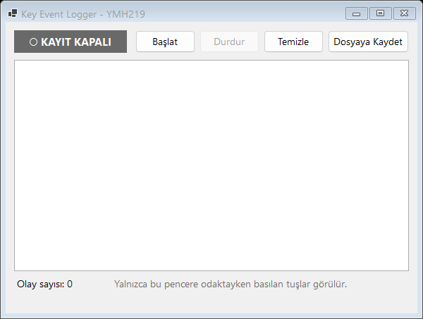
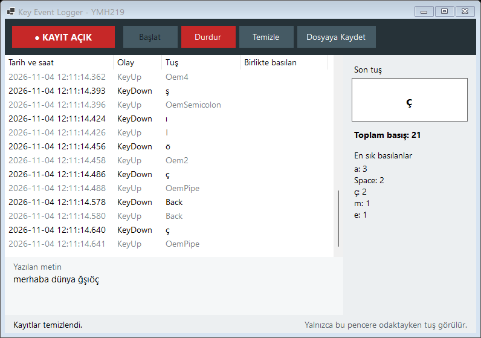

# YMH219 - Key Event Logger

Windows Forms klavye olaylarının nasıl çalıştığını gösteren eğitsel bir uygulama. Yalnızca kendi penceresi odaktayken basılan tuşları, tuş adı ve zamanla birlikte listeler. YMH 219 Nesne Tabanlı Programlama dersi uygulama ödevidir.

**Öğrenci:** Muhammet Yusuf Başçı - Öğrenci No: 235541023

## Kapsam ve Güvenlik Sınırı

Bu uygulama gerçek bir sistem keylogger'ı değildir.

- Yalnızca formun kendi `KeyDown` ve `KeyUp` olaylarını kullanır. Global klavye kancası yoktur.
- Gizli veya arka planda çalışmaz, başlangıçta otomatik açılmaz.
- Parola alanı içermez, başka uygulamalardan veri toplamaz.
- Ağ kullanmaz. Dosyaya yalnızca kullanıcı **Dosyaya Kaydet** dediğinde, seçtiği yere yazar.

## Kullanılan Teknolojiler

- C# / .NET 8, Windows Forms
- NuGet paketi yok

## Kurulum ve Çalıştırma

Gereken: .NET 8 SDK veya Visual Studio 2022.

- Visual Studio: `YMH219-KeyEventLogger.sln` dosyasını açın, `KeyEventLogger` projesini başlangıç projesi yapın, F5'e basın.
- Komut satırı: `dotnet run --project KeyEventLogger`
- Kayıt mantığının öz denetimi: `dotnet run --project KeyEventLogger.Tests`

## Temel Özellikler

- Basılan ve bırakılan tuşun adı, Ctrl/Shift/Alt bilgisi ve milisaniyeli zamanı listede görünür
- **Başlat** ve **Durdur** ile kayıt kontrolü
- Her zaman görünen kayıt göstergesi: `● KAYIT AÇIK` / `○ KAYIT KAPALI`
- **Temizle** ile listeyi silme
- **Dosyaya Kaydet** ile `.txt` dosyasına yazma; yazılamazsa uygulama kapanmaz, hata mesajı gösterilir
- Kayıt sırasında Tab, ok tuşları, Boşluk ve Enter da yakalanır. Bu tuşlar butonlara basmaz.

Kayıt satırı biçimi:

```
2026-11-03 21:50:01.123 | KeyDown | A | Shift
```

## Sınıf Yapısı

| Sınıf | Görevi |
|---|---|
| `KeyEventRecord` | Tek bir tuş olayı ve satır biçimi |
| `KeyEventLog` | Kayıt durumu, olay listesi ve dosyaya yazma |
| `MainForm` | Klavye olayları, butonlar ve gösterge |

## Ekran Görüntüleri





## Bilinen Sınırlamalar

- Kayıt sırasında klavye butonlara basamaz. Durdurmak için fare veya `Alt+D` kullanılır.
- Liste bellekte tutulur, uygulama kapanınca kaydedilmemiş olaylar kaybolur.
- Tuş istatistiği ve tarih aralığı filtresi yoktur.
